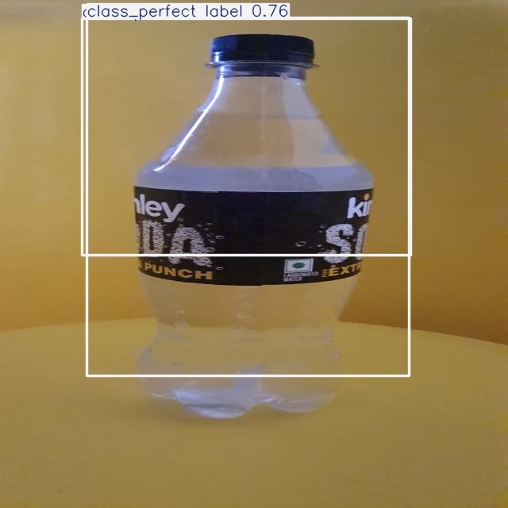
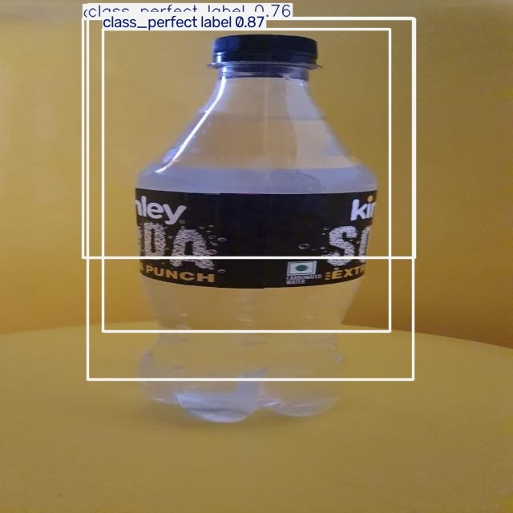

# Visual Evidence and Media Assets

[Project overview](../README.md) · [Reports](../reports/README.md)

This directory holds actual research visualizations and reproducible user-interface evidence. The presence of a graphic does not establish a model's correctness unless the underlying experiment or inference request is documented.

## Research figures (`plots/`)

**Dataset class examples and annotations:**

**Held-out detection predictions:**

**Split statistics:**

**Near-duplicate manual-review candidates:**

These plots came from an executed research run. Retain the relevant report, notebook cell or manifest needed to interpret each one. The near-duplicate figure shows *candidates*, not confirmed leakage cases.

## Example images (`examples/`)

Tracked examples `test_00.jpg` through `test_11.jpg` were generated as example material from the research pipeline. Some are **already annotated with text and bounding boxes** and therefore are *not suitable as clean source images for independent accuracy evaluation*.

In a local direct Ultralytics GPU smoke test of `test_01.jpg`, the model returned one `class_perfect label` detection with confidence about 0.8677. The input itself had earlier detection boxes burned into its pixels; do not treat this as a fresh held-out accuracy test.

## Application screenshots (`screenshots/`)

This screenshot illustrates the working React/FastAPI flow on an annotated sample image. It verifies the UI displayed a backend result in that local session, **not calibration, plant safety, or external generalization**.

## Diagrams (`diagrams/`)

The diagram folder is reserved for *real* architecture/pipeline diagrams, with their source format and version. Do not insert AI-generated fictitious screenshots or execution charts that resemble evidence. Use `.gitkeep` for empty folders until relevant assets exist.

## Asset management policy

Keep visual assets reasonably compressed and attributed, avoid exposing private/industrial information, document whether each example is raw/ground-truth/previously annotated/API output, and use relative paths in Markdown so images render both locally and on GitHub.
