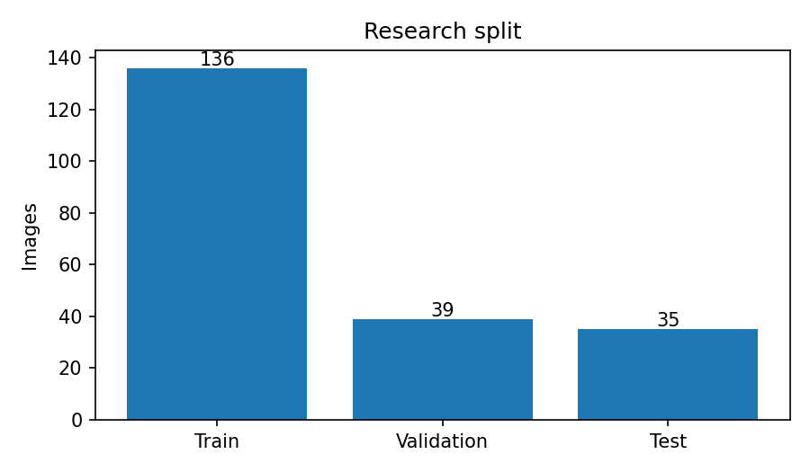
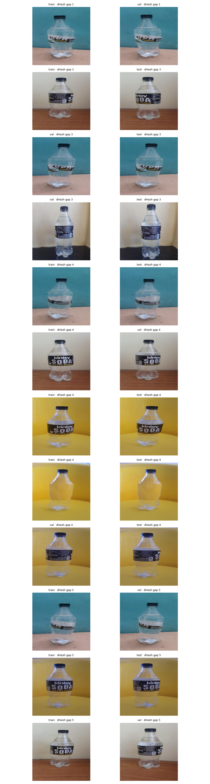
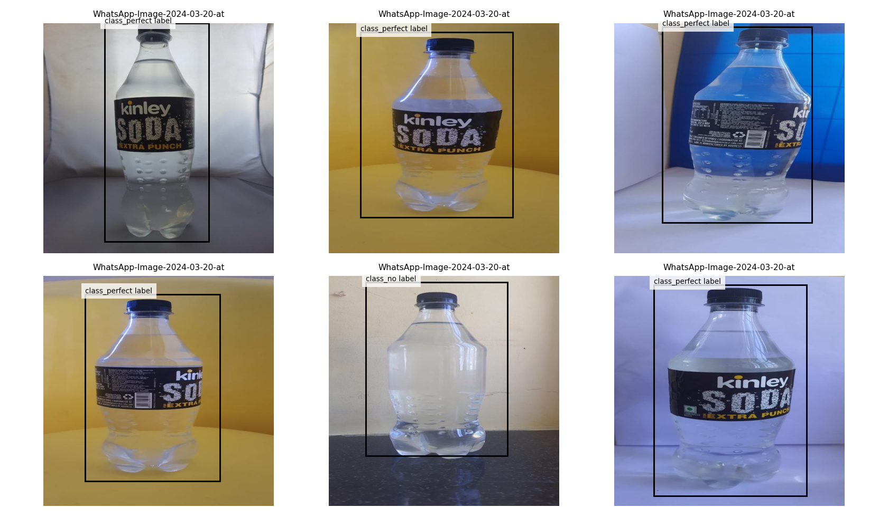

# Dataset, Provenance, dan Audit — LabelAlignment QA

[Indeks ID](README.md) · [Versi English](../en/DATASETS.md) · [Laporan asli](../../reports/README.md)

## Daftar sumber terinventarisasi (29 Oktober 2026)

| ID | Sumber resmi | Jumlah inventaris | Penggunaan |
|---|---|---:|---|
| `label_v2` | [Bottle Label Detection v2](https://www.kaggle.com/datasets/loliwibu/bottle-label-detection-v2) | 210 | **Sumber primer training/evaluasi** |
| `big_cola` | [Big Cola Bottles](https://www.kaggle.com/datasets/youssefeldemerdashh/big-cola-bottles-dataset-for-yolo-quality-control) | 377 | Audit inventaris saja |
| `label_other` | [Bottle Label Detection](https://www.kaggle.com/datasets/yashvisave/dataset-for-bottle-label-detection) | 396 | Audit inventaris saja |
| `water_defects` | [Water Bottle Defect](https://www.kaggle.com/datasets/jihadakbr/water-bottle-defect-level-detection-dataset) | 1.500 | Audit inventaris saja; ontologi berbeda |

Sumber dan peran berasal dari `reports/dataset_provenance.csv` dan `reports/source_comparison.json`. Versi penerbit, lisensi dan izin redistribusi masing-masing dataset **belum diverifikasi sepenuhnya**. Dataset sekunder tidak digabungkan; jumlah seluruh inventaris bukan ukuran dataset training.

## Ontologi label primer — urutan wajib

| ID | Label sumber | Interpretasi |
|---:|---|---|
| 0 | `class_imperfect label` | Kelas imperfect menurut anotasi sumber; bukan bukti nilai offset terukur |
| 1 | `class_no label` | Kelas tanpa label menurut anotasi sumber |
| 2 | `class_perfect label` | Kelas perfect menurut anotasi sumber; bukan kelulusan toleransi pabrik |

Nama dengan spasi harus dipertahankan persis pada model, schema respons, dan laporan. `reports/primary_audit.json` mencatat 62 imperfect, 26 no-label, dan 122 perfect sebagai **jumlah bounding box pada audit sumber**, bukan jumlah gambar per kelas pada held-out.

## Split dan audit kebocoran

`reports/split_policy.json` mencatat kebijakan `group_holdout_from_original_train`, seed 42, 136/39/35 untuk train/validation/test. Kebijakan ini mempertahankan holdout dari data sumber, tetapi belum memastikan semua kamera, sesi atau produk sepenuhnya independen. `reports/cross_split_collisions.json` melaporkan tidak ada collision SHA256/family yang ditemukan; pemeriksaan ini terbatas.

`reports/visual_leakage_audit.json` melaporkan **26 kandidat** lintas split dari dHash 8×8 ambang 5. Kandidat memerlukan inspeksi manusia untuk membedakan duplikat nyata dari botol serupa. Jangan melabel semuanya sebagai kebocoran terkonfirmasi; jangan pula mengklaim tanpa kebocoran.

## Standar audit lanjutan

1. Simpan fingerprint gambar, identitas file dan split sebagai manifest; jangan ubah test demi memperbaiki skor.
2. Tinjau 26 pasangan kandidat secara manual dan laporkan keputusan satu per satu.
3. Verifikasi koordinat, class ID, gambar rusak, gambar tidak beranotasi dan gambar multi-objek.
4. Bila mengevaluasi sumber tambahan, lakukan pemetaan label eksplisit dan evaluasi terpisah sebelum penggabungan.
5. Rekam hash dataset/manifest dan versi dependensi untuk percobaan berikutnya.

## Artefak sumber-of-truth

- `reports/primary_audit.json`, `reports/source_inventory.json`, `reports/dataset_provenance.csv`
- `reports/split_policy.json`, `reports/research_split_manifest.csv`, `reports/split_per_class_counts.csv`
- `reports/near_duplicate_candidates.csv`, `reports/visual_leakage_audit.json`, `reports/cross_split_collisions.json`
- `reports/dataset_split_fingerprint.json` dan `notebooks/labelalignment-qa.ipynb`

**Batas klaim:** audit jumlah gambar dan label bukan sertifikasi kebenaran semua anotasi; file contoh bergambar kotak prediksi tidak boleh dianggap input mentah.
