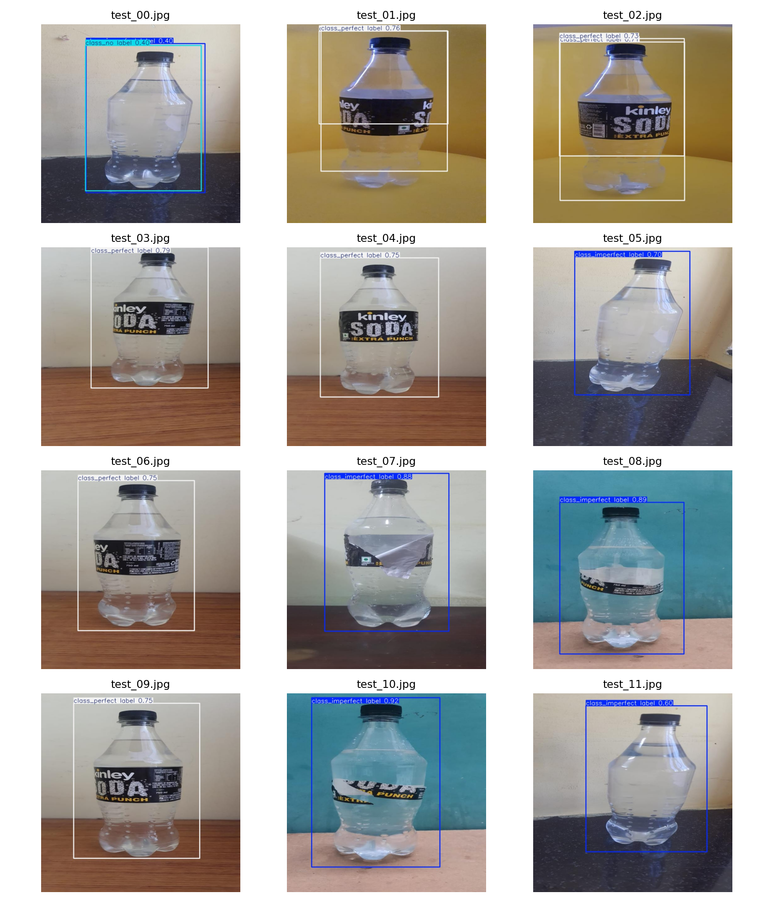

# Research Notebook — Day 24

[Project overview](../README.md) · [Methodology](../docs/METHODOLOGY.md) · [Evidence](../reports/README.md)

## Role and source of truth

`labelalignment-qa.ipynb` is the primary executable research record. Its experiment outputs are captured in `../reports/`; **reported figures are taken from saved experiment reports**, not re-estimated from interface screenshots. Keep original experiments in order and append numbered amendments rather than rewriting executed results.

## Scope and actual inputs

Primary Kaggle dataset: `loliwibu/bottle-label-detection-v2`, mounted at `/kaggle/input/datasets/loliwibu/bottle-label-detection-v2` in the recorded run. Other sources were inventoried, **not merged**. Three classes are mapped identically from notebook through exported checkpoint and API: `0 class_imperfect label`, `1 class_no label`, `2 class_perfect label`.

The source inventory found 210 primary images, distributed into 136 train, 39 validation, and 35 held-out test via `group_holdout_from_original_train`, random seed 42. The source annotations concern object detection of label conditions. The recorded notebook uses YOLOv8n and exports `.pt` and `.onnx` artifacts. `../reports/onnx_export.json` records export success, but a separate runtime-equivalence benchmark has not been demonstrated.

## Reproduction on Kaggle

1. Attach the original datasets referenced in [`../reports/dataset_provenance.csv`](../reports/dataset_provenance.csv); verify publisher permissions first.
2. Open `labelalignment-qa.ipynb`, inspect its configuration and mounted paths, then run cells in order. Preserve random seeds, split manifest, software versions and generated output directory.
3. Compare produced `split_policy.json`, `training_run.json`, `primary_heldout_metrics.json`, `research_gate.json` and other reports with the tracked records. Differences should be logged, never silently overwritten.
4. Export the checkpoint and actual manifests from the notebook's artifact directory; do not commit raw source dataset by default.

Running locally requires adapting Kaggle paths and having equivalent data access. A successful notebook import does not imply successful full reproduction.

## Evidence views

## Experiment governance

- **Experiment 01:** existing completed YOLOv8n research. Training report records 90.18 seconds for its environment and software; time is not a portable runtime guarantee.
- **Experiment 02 onward:** only if justified by audit or new evidence; document hypothesis, changed variables, independent validation, selection metric, test-lock policy, and results in a new section at the bottom of the notebook.
- Model selection uses validation, not held-out test. Don't use test results for parameter tuning and then call the same set independent.
- Do not claim that near-duplicate inspection is complete while 26 dHash candidate pairs remain unreviewed.

## Result interpretation

Held-out precision 0.7827, recall 0.9258, mAP50 0.9870, mAP50–95 0.7395 on **35 images**. Per-class AP50–95 is 0.7930 imperfect, 0.74645 no label, 0.67907 perfect. These are **object detection metrics** on a small source-domain holdout, not label-tilt measurement or plant-ready pass/fail.

For model location, API usage, and local testing, see [`../models/README.md`](../models/README.md) and [`../backend/README.md`](../backend/README.md).
